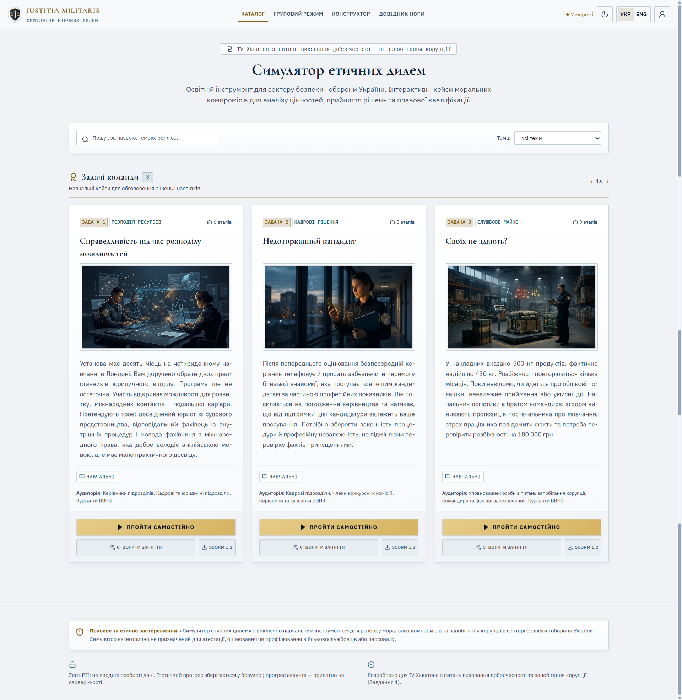

# Iustitia Militaris — Симулятор етичних дилем

Команда «Iustitia Militaris» · Завдання 1. Симулятор етичних дилем

## Проблема і користувач

Курсанти, військовослужбовці та викладачі працюють із рішеннями, де стикаються службова доцільність, право й довіра. Знання норми не завжди допомагає побачити наслідки вибору. Симулятор дає змогу розібрати такі ситуації без використання реальних службових даних. Викладач може провести обговорення індивідуально або в групі.

## Що робить рішення

- Пропонує три базові кейси з розгалуженнями й UKR/ENG.
- Показує наслідки та три окремі шкали через «Тактичний трекер».
- Підтримує таймери без обмеження, 10 і 15 хвилин та окремі збереження прогресу.
- Проводить анонімне групове голосування з QR, SVG-відсотками й локальним розбором А–Г.
- Дає «5 перевірок CIDS» та довідник із 60 перевірених норм.
- Зберігає власні задачі з прев’ю, запускає їх у групі й експортує SCORM 1.2.

## Демонстрація

Відео до 3 хв на YouTube: [Переглянути відео.](https://youtu.be/rUBW6dLR4Yc)

## Як запустити

Потрібні Node.js 18+, npm, Python 3 та сучасний браузер.

1. `git clone https://github.com/IustitiaMilitaris/IustitiaMilitaris.git`
2. `cd IustitiaMilitaris`
3. `npm ci`
4. `python3 zibraty.py && npm run build`
5. `npm start` — відкрити `http://localhost:3000` або LAN URL із консолі.

Змінні перелічено в [.env.example](.env.example); значення передаються через середовище процесу, автоматичного читання .env немає. Серверні дані не публікуйте. HTTP за LAN IP не гарантує доступності Service Worker; для PWA потрібен захищений контекст або localhost.

## Як влаштовано

React/TypeScript/Tailwind CSS → компоненти `src/components/` → JSON-графи `stsenarii/` і `normy.json`. Express/ws → групові кімнати в RAM, локальні акаунти й файлові задачі. Vite збирає клієнт; History API у `src/App.tsx` забезпечує маршрутизацію. Переклади лежать у `src/i18n/`.

Пункт 4 Політики ШІ: вибір знаходить записаний варіант; `nastupnyi_vuzol` задає перехід, `naslidky` — наслідки, `chomu_taki_baly` і `zvorotnyi_zviazok` — пояснення. Значення `dobrochesnist`, `efektyvnist`, `dovira` накопичуються незалежно, без єдиного бала. LLM у runtime немає. SCORM передає LMS статус проходження, без кадрового рейтингу.

У базі 60 перевірених норм: 57 зі статусом `zvireno` і 3 — `zvireno-rekomendatsiinyi`. Статуси надано командою 20.11.2026. Дві постанови: ВП ВС № 9901/72/19 і ККС ВС № 335/10825/16. UI показує офіційні назви й номери актів: ЗУ № 1700-VII, ЗУ № 4742-IX, КЗпП, ККУ, Конституція та короткий пункт усередині бейджа.

Три захищені базові кейси — ЗАДАЧА 1–3. Конструктор зберігає ЗАДАЧІ 4+ у `server/data/custom-scenarios/` (або в `DATA_DIR/custom-scenarios/`), окремо — прев’ю в `images/`. Є перевірка JSON, запуск у групі, завантаження PNG/JPEG/WebP, видалення з підтвердженням назви та автоматична перенумерація користувацьких задач. Базові кейси не видаляються цим API.

Захист: hostSecret, scrypt, підписані сесії, перевірка Origin, rate limiting і CSP. Zero-PII: не вводьте реальні ПІБ, звання, номери частин і службові відомості. LAN IP відстежується динамічно; зміна origin не переносить локальну авторизацію автоматично.

## Документація

| Матеріал | Де переглянути |
|---|---|
| Робочий прототип: локально, LAN Wi-Fi, офлайн PWA | [Запуск нижче](#як-запустити), [режими розгортання](docs/integration-map.md) |
| Опис архітектури | [docs/architecture.md](docs/architecture.md) |
| Сценарії та логіка оцінювання | [docs/scenarios-and-scoring.md](docs/scenarios-and-scoring.md), [stsenarii.md](stsenarii.md) |
| Машиночитані сценарії | [stsenarii/](stsenarii/): тільки S01–S03 |
| Норми, схема та валідатор | [normy.json](normy.json), [perelik-norm.md](perelik-norm.md), [schema.json](schema.json), [zibraty.py](zibraty.py) |
| Інтеграція та масштабування | [docs/integration-map.md](docs/integration-map.md) |
| Розрахунок економії часу | [docs/time-savings.md](docs/time-savings.md) |
| Зловживання та запобіжники | [docs/abuse-and-safeguards.md](docs/abuse-and-safeguards.md) |
| Як ми використали ШІ | [docs/ai.md](docs/ai.md) |
| Артефакти процесу команди | [docs/process/README.md](docs/process/README.md) |
| Відео демонстрації | [Посилання на відео демонстрації (до 3 хв)](https://youtu.be/rUBW6dLR4Yc) |
| Презентація для фіналу | [presentation/ВІЙСЬКО - ЮРИДИЧНИЙ ІНСТИТУТ.pdf](presentation/ВІЙСЬКО%20-%20ЮРИДИЧНИЙ%20ІНСТИТУТ.pdf) |

- [docs/abuse-and-safeguards.md](docs/abuse-and-safeguards.md) — Зловживання та запобіжники.
- [docs/ai.md](docs/ai.md) — Як ми використали ШІ.
- [docs/architecture.md](docs/architecture.md) — Архітектура.
- [docs/cases-source-review.md](docs/cases-source-review.md) — Підготовка трьох нових кейсів.
- [docs/custom-scenarios.md](docs/custom-scenarios.md) — Користувацькі сценарії.
- [docs/integration-map.md](docs/integration-map.md) — Інтеграція та розгортання.
- [docs/legal-verification-pending.md](docs/legal-verification-pending.md) — Звірка правових джерел.
- [docs/process/README.md](docs/process/README.md) — Артефакти процесу команди.
- [docs/scenarios-and-scoring.md](docs/scenarios-and-scoring.md) — Сценарії та логіка оцінювання.
- [docs/security-hardening.md](docs/security-hardening.md) — Захист застосунку.
- [docs/time-savings.md](docs/time-savings.md) — Розрахунок економії часу.
- [stsenarii.md](stsenarii.md) — зібрані сценарії.
- [perelik-norm.md](perelik-norm.md) — зібраний перелік правових джерел.

## Що використали

React/React DOM, TypeScript, Vite, Tailwind CSS, Express, ws, JSZip, QRCode, Lucide React, clsx і tailwind-merge; Playwright для браузерних перевірок. React Router не встановлено. Посібник CIDS 2025 використано як методичну основу; правова база — normy.json, структура й перевірка — schema.json / zibraty.py. Інструменти ШІ: Claude, Codex/ChatGPT, Gemini; межі застосування описано в docs/ai.md. Ліцензія — [MIT](LICENSE).
